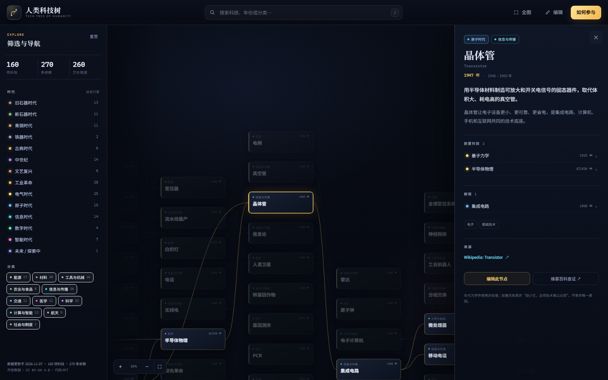

# 人类科技树 · Tech Tree of Humanity

> 从 260 万年前的打制石器，到 2026 年的通用人工智能设想：一张可缩放、可检索、人人可参与编辑的技术依赖图谱。

人类科技树用 **有向无环图（DAG）** 记录“什么前置技术，才可能解锁什么后置技术”。它想回答的不是“谁更聪明”，而是：**一项技术，站在哪些肩膀之上？**

当前种子数据包含 **160 项科技、270 条依赖**，覆盖旧石器时代到智能时代。数据以 CC BY-SA 4.0 开放，代码以 MIT 开放。



---

## 现在能做什么

- **依赖树，而不是时间轴**：横轴是依赖深度，所有箭头向右；纵轴按父子重心排序，减少交叉。
- **缩放 / 平移 / 小地图**：缩小到 50% 以下会自动退化成“星图”点阵，方便看全局结构。
- **搜索与筛选**：按名称、英文名、标签、简介、年份搜索；按 14 个时代、11 个分类筛选。
- **链路高亮**：选中一项技术，自动高亮它的全部前置与后继，其他节点变暗。
- **详情面板**：年代、分类、状态、简介、长说明、前置、解锁、来源、标签、维基百科查证入口。
- **浏览器内编辑**：新增、修改、删除；前置多选；自动校验缺失字段、断链、循环依赖和年代倒挂。
- **本地草稿**：静态模式下改动自动存进 `localStorage`，刷新不丢；随时查看差异、导出完整 `tech.json`。
- **实时协作模式**：`npm run live` 启动零依赖 Node 服务器，账号登录、SSE 实时广播、版本历史、管理员回滚。
- **零运行时依赖**：原生 ES Modules、SVG、Canvas；实时服务器只用 Node 内置模块，没有 npm 依赖。

---

## 快速开始

浏览器出于安全原因不允许 `file://` 页面读取本地 JSON，所以需要一个服务器。有两种模式：

### 静态模式（无需账号，零后端）

```bash
# 任选一种
python -m http.server 4173
# 或
npm run dev
```

然后打开 **http://localhost:4173**。编辑只存在浏览器草稿里，导出 JSON 后通过 Git/Issue 提交。

### 实时协作模式（账号 + 实时广播）

```bash
npm run live
```

然后打开 **http://127.0.0.1:4174**。首次启动会创建管理员账号，密码打印在控制台并写入 `server/data/FIRST_ADMIN.txt`。注册后即可编辑，保存会立即广播给所有在线页面。

> `npm run dev` 和 `npm run live` 都是零依赖 Node 服务器（Node 18+），不会安装任何包。完整后端说明见 [server/README.md](server/README.md)。

### 常用命令

```bash
npm run dev        # 静态预览，默认 http://127.0.0.1:4173
npm run live       # 实时协作服务器，默认 http://127.0.0.1:4174
npm run promote    # 把 server/data/tech.json 校验后同步回 data/tech.json
npm run validate   # 校验 data/tech.json（CI 使用同一套规则）
npm run build      # 生成 dist/，可部署到任意静态托管
```

---

## 项目结构

```
.
├─ index.html              # 页面骨架
├─ assets/
│  ├─ styles.css           # 视觉与响应式
│  └─ favicon.svg
├─ src/
│  ├─ app.js               # 启动、搜索、筛选、详情、草稿、实时账户
│  ├─ graph.js             # 画布渲染、缩放/平移、高亮、小地图
│  ├─ layout.js            # DAG 分层布局
│  ├─ editor.js            # 编辑表单、指南、差异面板
│  ├─ live.js              # 实时客户端：API、SSE、登录状态
│  ├─ validate.js          # 浏览器 + CI + 服务器共用的数据校验
│  ├─ constants.js         # 时代、分类、状态、年代格式化
│  ├─ config.js            # 站点配置（仓库地址等）
│  ├─ store.js             # 数据读取与 localStorage 草稿
│  ├─ diff.js              # 草稿差异
│  └─ modal.js             # 模态框与 toast
├─ server/
│  ├─ index.mjs            # 零依赖 Node：账号 / API / SSE / 快照 / 静态站
│  └─ README.md            # 实时服务器部署与安全说明
├─ data/
│  ├─ tech.json            # 静态模式的科技数据源
│  └─ schema.json          # JSON Schema，供编辑器和 CI 参考
├─ scripts/
│  ├─ serve.mjs            # 零依赖开发服务器
│  ├─ validate-data.mjs    # 数据校验入口
│  ├─ promote-live.mjs     # 实时数据同步回 data/tech.json
│  └─ build.mjs            # 复制静态文件到 dist/
├─ docs/
│  ├─ roadmap.md           # 协作架构与规模化路线图
│  └─ preview.png
├─ Dockerfile              # 实时服务器的单镜像部署
└─ .github/
   ├─ workflows/           # 校验 + GitHub Pages 部署
   └─ ISSUE_TEMPLATE/      # 不会用 Git 也能提交建议
```

---

## 数据格式

一项科技就是一个节点，前置关系写在 `prereqs` 里，边由程序自动生成：

```json
{
  "id": "transistor",
  "name": "晶体管",
  "nameEn": "Transistor",
  "year": 1947,
  "era": "atomic",
  "category": "information",
  "summary": "用半导体材料制造可放大和开关电信号的固态器件。",
  "description": "晶体管让电子设备更小、更可靠、更省电……",
  "prereqs": ["semiconductor-physics", "quantum-mechanics"],
  "tags": ["电子", "基础技术"],
  "sources": [
    {
      "label": "Wikipedia: Transistor",
      "url": "https://en.wikipedia.org/wiki/Transistor"
    }
  ],
  "status": "established"
}
```

### 必填字段

| 字段 | 说明 |
| --- | --- |
| `id` | 小写字母、数字、连字符；全库唯一，发布后不要改 |
| `name` | 中文名称，建议 ≤ 20 字 |
| `year` | 整数；公元前用负数，如 `-3200` |
| `era` | 见 `src/constants.js` 的 14 个时代 key |
| `category` | 见 11 个分类 key |
| `summary` | 一句话说明“它解决了什么问题”，≤ 180 字 |
| `prereqs` | 前置科技 id 数组；没有前置写 `[]`，表示树根 |

### 可选字段

`nameEn`、`description`、`approx`（年代为约数）、`tags`、`sources`、`status`（`experimental` / `speculative` / `disputed`）。

完整约束见 [`data/schema.json`](data/schema.json)。

---

## 三种协作方式

“人人可编辑”不等于“匿名直接写生产库”。没有账号、历史、审核和回滚的公开写入，通常几天内就会被广告和编辑战淹没。这个项目提供三条路径：

### A. 实时协作服务器（已实现，推荐给社区）

```bash
npm run live
```

- 账号注册/登录，密码 scrypt 哈希，HttpOnly 会话；
- 登录后直接编辑，保存立即写入服务器；
- SSE 把新数据实时广播给所有在线页面；
- 每次修改写入完整快照，管理员可回滚；
- 贡献者可增改，删除/恢复/导入仅管理员；
- 单机 JSON 持久化，适合一台 VPS / 内网 / 小社区。

详见 [server/README.md](server/README.md)。公开部署时建议设置 `REGISTRATION=closed`，由管理员创建邀请账号。

### B. 静态站 + Git（零服务器，适合开放数据）

1. 打开网站，点「编辑」，修改或新增科技。
2. 改动自动保存在**你自己的浏览器**里，不会自动同步给别人。
3. 点「草稿」→「导出 tech.json」，得到完整数据文件。
4. 提交给维护者：
   - **会用 Git**：Fork 仓库 → 用导出的文件替换 `data/tech.json` → 提 Pull Request。
   - **不会 Git**：通过仓库的 Issue 模板提交“科技建议”，附上 JSON 或字段；维护者代为合并。
5. GitHub Actions 自动运行 `npm run validate`。校验通过 + 维护者审核后合并，网站自动重新部署。

这条路径的优点是：**零成本、可审计、可回滚、不会被匿名脚本刷爆**。

### C. 多实例 / 托管数据库（规模化时）

当单个 JSON 文件和一台服务器不够时，升级到 Postgres/Supabase：

- 节点与边存表，`tech_edges` 保证 DAG；
- OAuth 登录 + RLS，普通用户提交建议、reviewer 发布；
- `revisions` 存版本，支持 diff、回滚、封禁；
- Realtime 订阅 + 乐观更新；
- 夜间导出静态 JSON，网站继续走 CDN/Pages。

完整表结构、RLS 和迁移步骤见 [docs/roadmap.md](docs/roadmap.md)。

---

## 部署到 GitHub Pages

1. 新建仓库并推送本项目。
2. 仓库 **Settings → Pages → Build and deployment → Source** 选择 **GitHub Actions**。
3. 推送 `main` 后，`.github/workflows/deploy.yml` 会校验数据、构建 `dist/` 并发布。
4. 在 `src/config.js` 填入仓库地址（或留空，托管在 `*.github.io` 时会自动推断）：

```js
export const CONFIG = {
  repoUrl: "https://github.com/your-name/human-tech-tree",
  // ...
};
```

也可以部署到 Cloudflare Pages、Netlify、Vercel：构建命令 `npm run build`，输出目录 `dist`。

### 部署实时服务器

GitHub Pages / Cloudflare Pages 只能托管静态文件，**不能运行 `server/index.mjs`**。实时模式需要一台能跑 Node 的机器（VPS、Render、Fly.io、Railway 等）：

```bash
# 任选一种
npm run live
# 或
docker build -t human-tech-tree .
docker run -d -p 4174:4174 \
  -e HOST=0.0.0.0 \
  -e REGISTRATION=closed \
  -e ADMIN_PASSWORD='换成强密码' \
  -v human-tech-tree-data:/app/server/data \
  human-tech-tree
```

- 挂载持久磁盘到 `/app/server/data`，否则重启会丢数据；
- 用 HTTPS 反向代理（Caddy / Nginx / 平台自带域名）；
- 单实例运行，不要把同一个数据目录挂给多个进程；
- 详细环境变量、备份和安全清单见 [server/README.md](server/README.md)。

静态站和实时服务器可以并存：Pages 提供只读快照，实时服务器提供协作编辑；用 `npm run promote` 把实时数据同步回 `data/tech.json` 后重新部署静态站。

> 不熟悉 Git？看 [PUBLISH.md](PUBLISH.md) 里的 GitHub 网页上传步骤。

---

## 设计取舍

- **为什么横轴不是年份？** 因为历史依赖并不总是严格按年份发生（例如疫苗早于病菌学说）。按“依赖深度”布局能保证所有箭头向右，不会出现倒着长的枝干。年份仍显示在每张卡片和详情里。
- **为什么前置是“必要”而不是“相关”？** 相关关系会让图迅速退化成一张什么都连的网。这里要求：没有它，这项技术很难出现。
- **为什么数据是一个 JSON 文件？** 便于 review、diff、fork 和离线校验；160 项规模完全不需要数据库。实时服务器也用 JSON + 完整快照，先验证协作规则，再考虑 Postgres。
- **为什么实时服务器只支持单实例？** 多进程同时写一个 JSON 会互相覆盖。需要水平扩容时，按 roadmap 换成 Postgres/Supabase，而不是继续加文件锁。
- **为什么缩到很小会变成点？** 这是有意的语义缩放：概览看结构，放大看文字，避免 19% 缩放时出现无法阅读的蚂蚁字。

---

## 数据准确性

年代是学界常用近似值；早期技术的年代尤其存在争议。节点上的 `status` 和 `sources` 用于标记不确定性：

- `experimental`：实验/前沿，尚未大规模落地；
- `speculative`：推测/设想，例如 AGI；
- `disputed`：年代或归属有争议。

发现错误请提 Issue 或 PR，附上来源。不要因为“我觉得”而改年代。

---

## License

- 代码：[MIT](LICENSE)
- 数据：[CC BY-SA 4.0](https://creativecommons.org/licenses/by-sa/4.0/)（也可查看 [LICENSE-DATA](LICENSE-DATA)）—— 转载、改编请署名并以相同方式共享。

欢迎从任何一项你觉得“这不对”或“这还缺一块”的科技开始。
